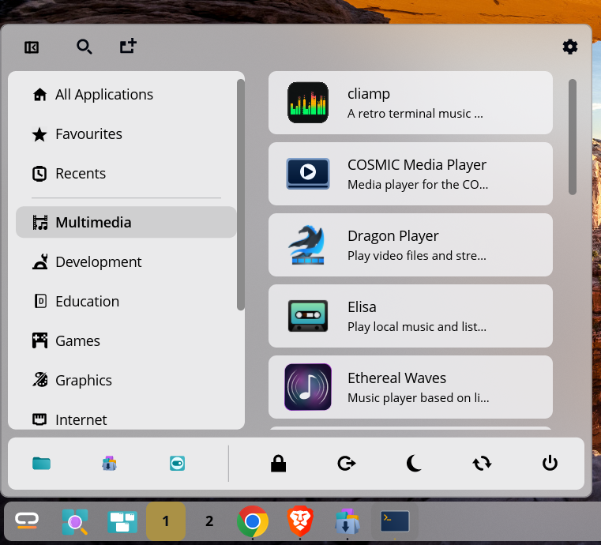
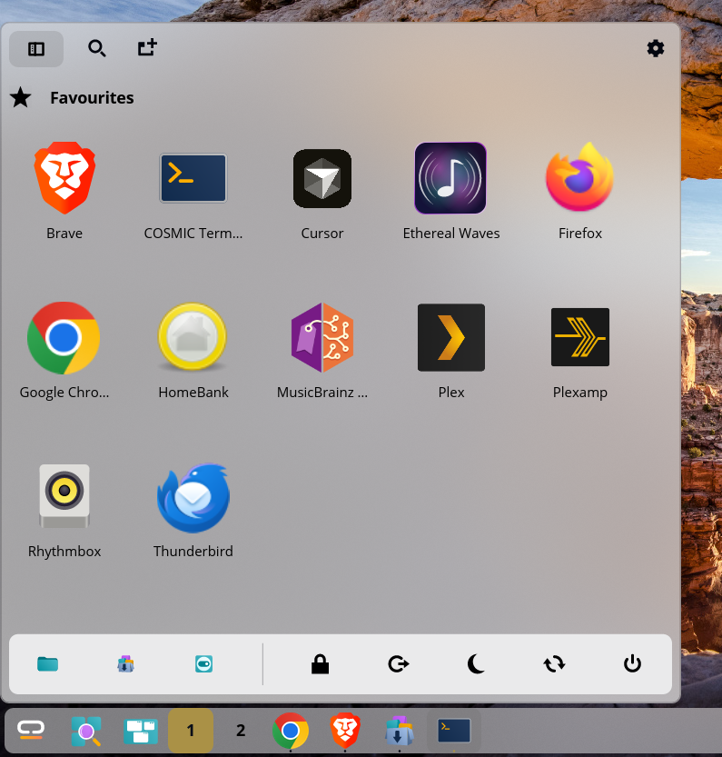
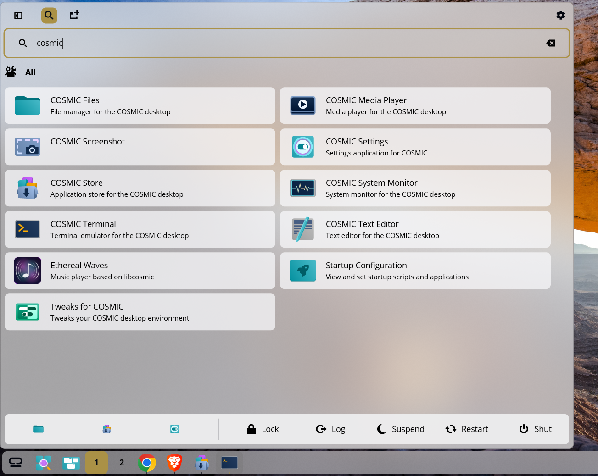
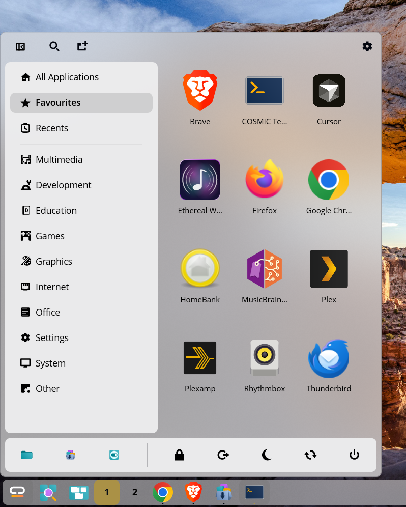
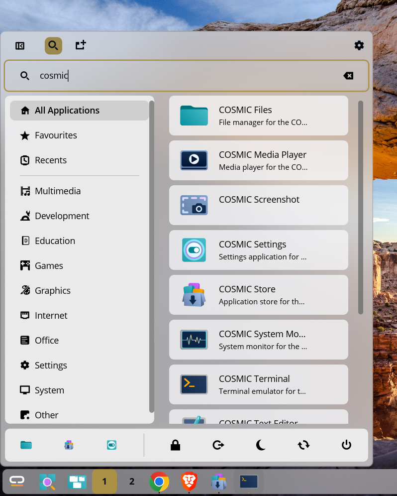

# Kickoff Launcher for the COSMIC™ desktop

A KDE Kickoff-style application menu for the [COSMIC™ desktop](https://github.com/pop-os/cosmic-epoch), built with [libcosmic](https://github.com/pop-os/libcosmic).

## Features

- Grid, list and hybrid layouts (the hybrid layout uses grids for Favourites and Recents)
- Configurable menu size presets and custom dimensions
- Favourites and recent applications
- Search installed apps by name, description or keyword
- Pin apps to the COSMIC dock
- Bottom bar with pinned apps and power actions
- Follows the active COSMIC DE theme, including light and dark appearance
- Panel icons in COSMIC, System76, KDE, Xfce, Haiku, Debian and other styles, with monochrome options
- Optional standalone window mode (`--window`)

## Layouts

Choose how apps are displayed. Hybrid uses a grid for Favourites and Recents, and a list for other categories.

<table>
  <tr><td></td><td><strong>Grid</strong><br>Browse apps by their icons.</td></tr>
  <tr><td></td><td><strong>List</strong><br>See app names and descriptions in rows.</td></tr>
  <tr><td></td><td><strong>Hybrid</strong><br>Favourites and Recents use the grid; other categories use the list.</td></tr>
</table>

## Menu sizes

Choose a preset to suit your screen and the number of apps you want to see. Presets include Small, Medium, Medium Square, Large, Tall, Square and Portrait. Custom lets you set the menu width and height.

<table>
  <tr><td></td><td><strong>Small</strong><br>A compact menu with the sidebar, app list and bottom bar visible.</td></tr>
  <tr><td></td><td><strong>Square</strong><br>A square app grid with the sidebar collapsed to give icons more room.</td></tr>
  <tr><td></td><td><strong>Large</strong><br>Shows apps in a list with names and descriptions. The menu scales to the available screen space, so the number of visible rows can vary by display size.</td></tr>
</table>

## Screenshots

The launcher follows the active COSMIC DE theme. The examples below show light mode, search, and the available layouts and settings.

<table>
  <tr><td></td><td><strong>Light mode</strong><br>The launcher follows the active light theme.</td></tr>
  <tr><td></td><td><strong>Search</strong><br>Type in the search field to find apps by name, description or keyword. Results update as you type.</td></tr>
  <tr><td></td><td><strong>Recent apps</strong><br>Apps you have opened recently appear here.</td></tr>
  <tr><td></td><td><strong>Favourites</strong><br>Your favourite apps in a grid, with the category list alongside.</td></tr>
  <tr><td></td><td><strong>List view</strong><br>Apps appear with their names and descriptions.</td></tr>
  <tr><td></td><td><strong>Appearance settings</strong><br>Set the layout and menu size, and choose a panel icon.</td></tr>
  <tr><td></td><td><strong>All applications</strong><br>Browse installed apps by category.</td></tr>
  <tr><td></td><td><strong>Collapsed sidebar</strong><br>Collapse the sidebar to make more room for apps.</td></tr>
  <tr><td></td><td><strong>Sidebar and bottom bar</strong><br>Choose which sections and controls to show.</td></tr>
  <tr><td></td><td><strong>Bottom bar without pinned apps</strong><br>Hide pinned apps while keeping the power controls.</td></tr>
  <tr><td></td><td><strong>Bottom bar hidden</strong><br>Turn off both options to remove the bar.</td></tr>
  <tr><td></td><td><strong>Compact favourites view</strong><br>Favourites opens by default, with the sidebar and pinned apps hidden. Power controls remain in the bottom bar.</td></tr>
  <tr><td></td><td><strong>Standalone window</strong><br>The launcher can also run in its own desktop window.</td></tr>
</table>

## Settings

Settings are grouped into Appearance, Sidebar, Bottom Bar and Default Menu.

<table>
  <tr><td></td><td><strong>Appearance</strong></td></tr>
  <tr><td></td><td><strong>Sidebar, bottom bar, and default menu</strong></td></tr>
</table>

### Appearance

- **Layout:** Grid shows app icons in a grid. List shows app names and descriptions. Hybrid uses grids for Favourites and Recents, and a list for other categories.
- **Menu Size:** Choose a preset or set custom dimensions. See [Menu sizes](#menu-sizes).
- **Panel Icon:** Choose the icon for the panel button. Options include the launcher and COSMIC icons, plus icons from other menu styles.
- **Monochrome icon:** Use the symbolic version of the selected icon when one is available.

### Sidebar

- **Show Favourites** and **Show Recents:** Show or hide these sections in the sidebar.
- **Hide Sidebar by Default:** Start with the sidebar collapsed. You can still open it from the launcher.

### Bottom Bar

- **Show Pinned Apps:** Show your pinned apps in the bottom bar.
- **Show Power Actions:** Show session controls for locking, logging out, suspending, restarting or shutting down. Turn off both options to hide the bottom bar.

### Default Menu

- **Default Category:** Choose what opens with the launcher: All Applications, a populated Favourites or Recents list, or any installed app category.

## Building

Clone the repository and enter the project directory:

```
git clone https://github.com/justinkelly/cosmic-ext-kickoff-launcher.git
cd cosmic-ext-kickoff-launcher
```

Build and install for your user with:

```
just install-user
```

To reload the applet after installing, restart the COSMIC panel:

```
pkill -x cosmic-panel
```

COSMIC Session should start the panel again. If it does not, log out and back in.

Other useful `just` recipes:

```
just build-release # build an optimised binary
just run           # build and run
just run-window    # build and run in a standalone window
just install       # install system-wide (requires sudo)
just check         # clippy with pedantic warnings
```

## Licence

Licensed under the [GPL-3.0-only](LICENSE).

See [Third-party notices](THIRD_PARTY_NOTICES.md) for icon-theme and trademark
information, exact artwork sources, revisions, attributions, and licences.
